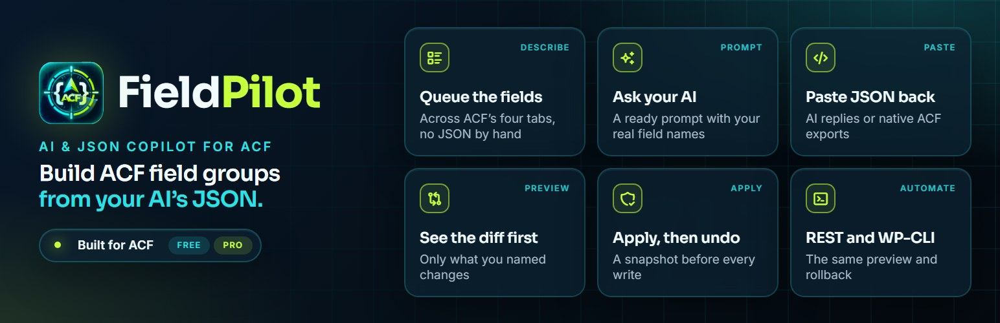
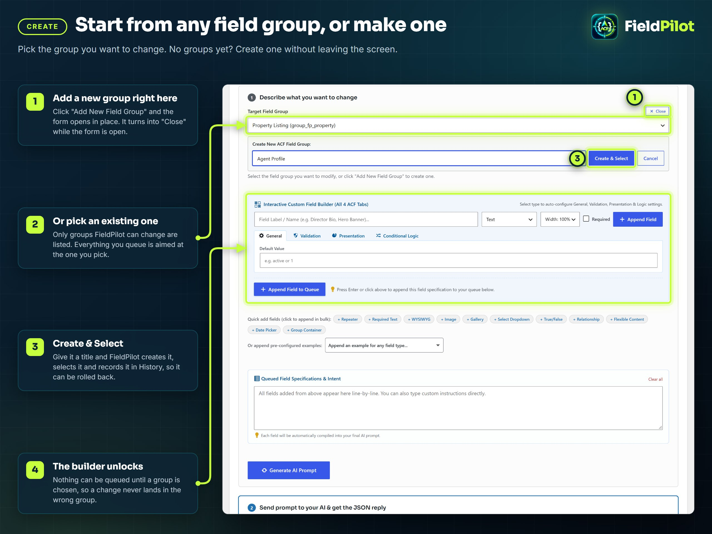
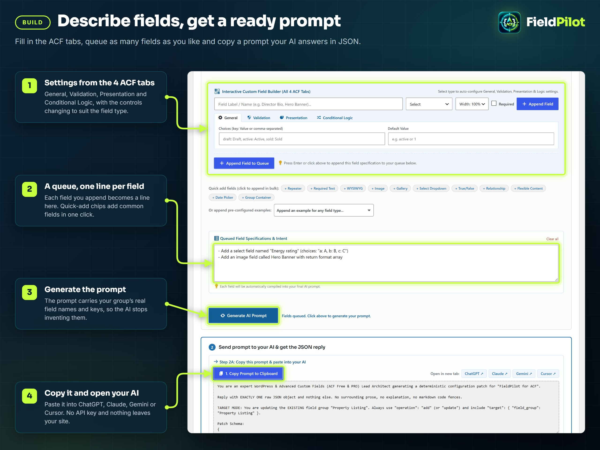
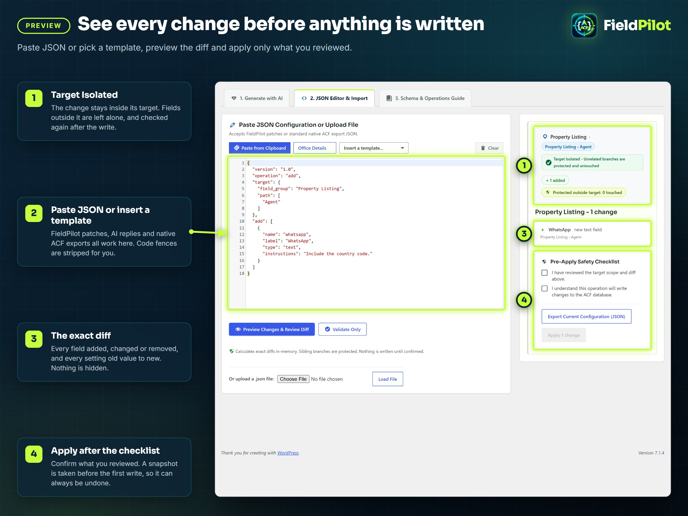
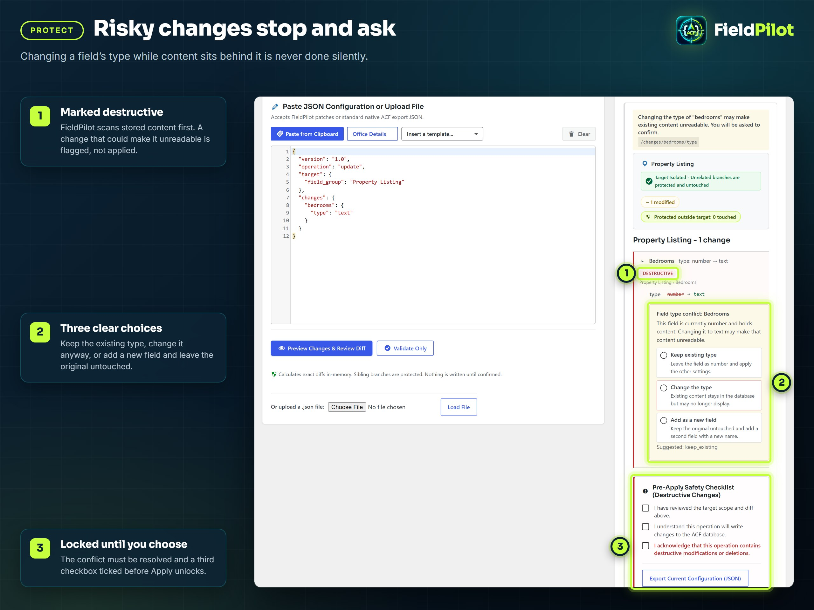
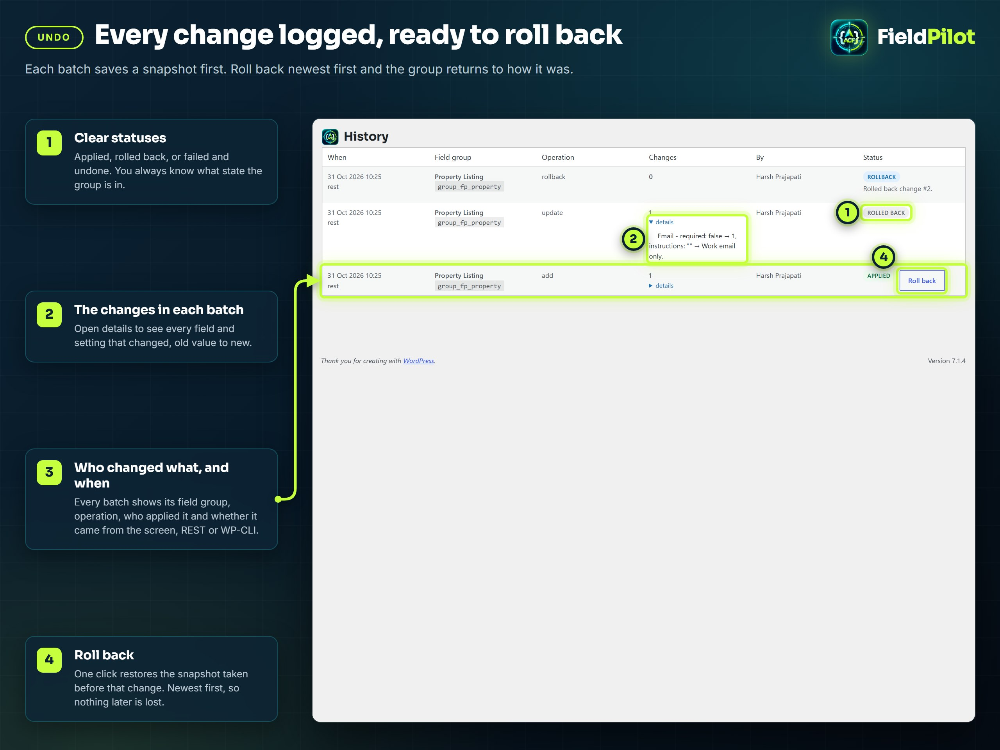
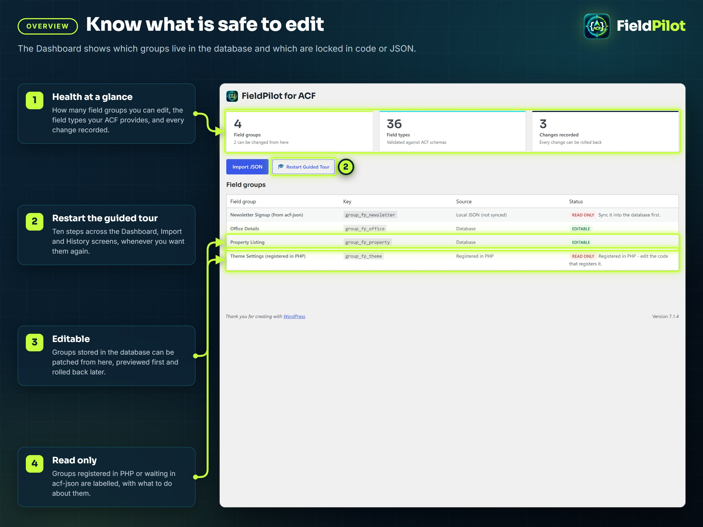

<p align="center">
  
</p>

<h1 align="center">
   FieldPilot: AI and JSON copilot for ACF
</h1>

<p align="center">
  <b>Change ACF field groups with JSON, from your AI or by hand, and never lose a field.</b><br>
  Preview the exact diff, apply only what you reviewed, and roll back when you are wrong.<br>
  Built for ACF free and PRO. No API keys, no external services, no tracking.
</p>

<p align="center">
  <a href="https://wordpress.org/plugins/fieldpilot-for-acf/"></a>
  <a href="https://downloads.wordpress.org/plugin/fieldpilot-for-acf.latest-stable.zip"></a>
</p>

<p align="center">
  
  
  
  
  
  
</p>

<p align="center">
  <a href="#start-from-any-field-group-or-make-one"><b>Create</b></a> ·
  <a href="#describe-fields-get-a-ready-prompt"><b>Build</b></a> ·
  <a href="#see-every-change-before-anything-is-written"><b>Preview</b></a> ·
  <a href="#risky-changes-stop-and-ask"><b>Protect</b></a> ·
  <a href="#every-change-logged-ready-to-roll-back"><b>Undo</b></a> ·
  <a href="#know-what-is-safe-to-edit"><b>Overview</b></a> ·
  <a href="#install-in-a-minute">Install</a> ·
  <a href="#faq">FAQ</a> ·
  <a href="#for-developers">Developers</a>
</p>

---

## What do you want to do?

Click a task to jump straight to how it works.

| I want to... | FieldPilot gives you | |
| --- | --- | --- |
| Add a field to a repeater without clicking through ACF | A JSON patch aimed at **one target**, with everything else left alone | [Show me](#see-every-change-before-anything-is-written) |
| Let my AI write the fields, without giving it my site | A **ready prompt** with your real field names; paste the JSON reply back | [Show me](#describe-fields-get-a-ready-prompt) |
| Make one field required and change nothing else | **Partial updates**: only the settings you name change | [Show me](#see-every-change-before-anything-is-written) |
| Know what a patch will do before it runs | A **diff preview**, old value to new, nothing hidden | [Show me](#see-every-change-before-anything-is-written) |
| Change a field's type without losing content | **Conflicts stop and ask**, with three clear choices | [Show me](#risky-changes-stop-and-ask) |
| Undo a change that broke the site | A **snapshot before every write** and one-click rollback | [Show me](#every-change-logged-ready-to-roll-back) |
| See which groups I can edit from here | The **Dashboard** labels database, PHP and acf-json groups | [Show me](#know-what-is-safe-to-edit) |
| Apply patches from a deployment | **REST and WP-CLI**, with the same preview and rollback | [Show me](#for-developers) |

> [!TIP]
> Nothing is written until you tick the safety checklist and click **Apply**. Every apply takes a snapshot
> first, checks every field in the group afterwards, and undoes itself if anything is off.

---

## Start from any field group, or make one



1. On **FieldPilot > Import JSON**, pick the **Target Field Group**. Only groups FieldPilot can change are listed.
2. No groups yet? Click **Add New Field Group**, type a title, click **Create & Select**. The group is created,
   selected and recorded in History, so it can be rolled back like anything else.
3. The custom field builder unlocks once a group is chosen, so a change never lands in the wrong group.

---

## Describe fields, get a ready prompt



1. Fill in a field across ACF's four tabs (General, Validation, Presentation, Conditional Logic) and click
   **Append Field to Queue**. Quick-add chips add common fields in one click; types your ACF cannot store are disabled.
2. Click **Generate AI Prompt**. The prompt carries your group's real field names and keys, and only the field
   types your site can use, so the AI stops inventing them.
3. **Copy** it, open ChatGPT, Claude, Gemini or Cursor, and paste the JSON reply back with
   **Paste AI Response & Switch to Editor**. Code fences are stripped and the preview runs.

No API key, nothing sent anywhere. You use whatever AI you already have.

<details>
<summary><b>What the prompt contains</b></summary>
<br>

- The patch schema and the eight operations, with an example of each.
- Your target group's current fields: names, keys, types and nesting, so updates address real fields.
- The field types available on this site (32 on ACF free, 36 on ACF PRO) and the ones to leave out.
- The settings behind each ACF tab, so `required`, `wrapper`, `conditional_logic` and friends come back in ACF's own shape.

</details>

---

## See every change before anything is written



1. Paste JSON into the editor, pick **Insert a template...**, or upload a `.json` file. FieldPilot patches,
   AI replies and native ACF exports all work.
2. Click **Preview Changes & Review Diff**. The right column shows the target breadcrumb, the
   **Target Isolated** badge, and every change with each setting old value to new.
3. Tick the checklist and click **Apply**. A snapshot is taken before the first write and every field in
   the group is re-read afterwards.

<details>
<summary><b>A patch that adds one field inside a group</b></summary>
<br>

```json
{
  "version": "1.0",
  "operation": "add",
  "target": { "field_group": "Property Listing", "path": ["Agent"] },
  "add": [
    { "name": "whatsapp", "label": "WhatsApp", "type": "text", "instructions": "Include the country code." }
  ]
}
```

Everything outside `Agent` is left exactly as it was, and FieldPilot checks that after the write.

</details>

<details>
<summary><b>A patch that changes one setting on one field</b></summary>
<br>

```json
{
  "version": "1.0",
  "operation": "update",
  "target": { "field_group": "Property Listing", "path": ["Agent"] },
  "changes": {
    "email": { "required": 1, "instructions": "Work email only." }
  }
}
```

Settings you leave out keep their values. Field keys are never regenerated, so stored content stays connected.

</details>

<details>
<summary><b>The eight operations</b></summary>
<br>

| Operation | What it does | Risk |
| --- | --- | --- |
| `add` | Adds fields or layouts to the target. Nothing else changes. | safe |
| `update` | Changes only the settings named, on the fields named. | safe |
| `create` | Creates a new field group with its fields. Rolling it back trashes the group. | safe |
| `move` | Moves a field to another container or position, keeping its key. | caution |
| `merge` | Adds what is missing, updates what is named, deletes nothing. | safe |
| `delete` | Removes the fields named. Content is scanned first. | destructive |
| `sync` | Makes the group match the payload, including removals. | caution |
| `replace` | Rebuilds the target from the payload. Matching fields keep their keys. | destructive |

Sloppy JSON is normalised, not rejected: `group` for `field_group`, `description` for `instructions`,
`true` where ACF wants `1`, paths written as `"Parent > Child"` or `"parent.child"`.

</details>

---

## Risky changes stop and ask



FieldPilot scans stored content before a change that could lose it: deleting a field or layout that holds
data, or changing a field's type. The change is marked **destructive** and nothing is written until you choose.

| Choice | What happens |
| --- | --- |
| **Keep existing type** | The type stays. Every other setting in the patch is applied. |
| **Change the type** | The type changes. Existing content stays in the database but may no longer display. |
| **Add as a new field** | The original is untouched and a second field with a new name is added. |

A third checkbox must be ticked before **Apply** unlocks for a destructive batch.

---

## Every change logged, ready to roll back



Every batch is recorded on **FieldPilot > History** with its field group, operation, who applied it and
where it came from (the screen, REST or WP-CLI). Open **details** to see each setting old value to new.

- **Roll back** restores the snapshot taken before that change. Rollbacks go newest first, so nothing later is lost.
- Statuses are explicit: **Applied**, **Rolled back**, **Failed - undone** and **Failed - needs restore**.
- If a write fails its own check, the snapshot is restored automatically and the batch is recorded as undone.

> [!IMPORTANT]
> FieldPilot's snapshots protect ACF field group configuration. They are not a site backup. Keep your
> regular database backups.

---

## Know what is safe to edit



The **Dashboard** shows how many groups you can edit, the field types your ACF provides, and every change
recorded. Groups stored in the database are **Editable**. Groups registered in PHP, or waiting in `acf-json`
and not yet synced, are **Read only**, with what to do about them. **Restart Guided Tour** replays the
ten-step tour across the Dashboard, Import and History screens.

---

## Install in a minute

1. **Plugins > Add New**, search for **FieldPilot**, install and activate. ACF (free or PRO) must already be active.
2. Open **FieldPilot** in the admin menu. The guided tour starts on the first visit.
3. Pick a field group on **Import JSON**, queue a field, generate the prompt, and paste the reply back.

Or from the command line:

```bash
wp plugin install fieldpilot-for-acf --activate
```

Requirements: WordPress 6.5+, PHP 8.1+, ACF 6.2+ (free or PRO). Repeater, Flexible Content, Clone and Gallery
need ACF PRO; Icon Picker needs ACF 6.3+. On ACF 6.8+, new fields are also checked against ACF's own
field-type schemas.

## Settings

**FieldPilot > Settings**:

| Setting | Default | What it does |
| --- | --- | --- |
| Read-only mode | Off | Previews, validation and exports keep working; applying and rolling back are refused. Also `define( 'ACFJP_READ_ONLY', true );` in `wp-config.php`. |
| Content detection | On | Scans posts, terms, users and options for a field's content before a delete or type change. |
| History per field group | 50 | Entries kept for each group before older ones are pruned. |
| History age limit | 90 days | Entries older than this are pruned. |
| Delete all FieldPilot data when the plugin is deleted | Off | When on, deleting the plugin removes its settings, history and snapshots. Field groups are never touched. |

## FAQ

<details>
<summary><b>Will this overwrite my existing fields?</b></summary>
<br>
No. An <code>update</code> changes only the settings your JSON names. Every other setting and every other
field is left as it was, and field keys are never regenerated, so no content is orphaned.
</details>

<details>
<summary><b>Does it work with ACF free?</b></summary>
<br>
Yes, with the 32 field types ACF free provides. Repeater, Flexible Content, Clone and Gallery are ACF PRO
features: FieldPilot shows them disabled and refuses payloads that use them, with a clear message.
</details>

<details>
<summary><b>Does it need an API key or send my data anywhere?</b></summary>
<br>
No. FieldPilot contains no AI integration. It generates a prompt for whichever AI you already use, and you
paste the reply back. Nothing leaves your server.
</details>

<details>
<summary><b>Why can't it edit one of my field groups?</b></summary>
<br>
Groups registered in PHP with <code>acf_add_local_field_group()</code> do not live in the database, so nothing
can be written to them. Groups from an <code>acf-json</code> file that has not been synced are the same. The
Dashboard labels every group; sync JSON groups into the database first.
</details>

<details>
<summary><b>How do I undo a mistake?</b></summary>
<br>
On <b>History</b>, click <b>Roll back</b> on the newest entry. It restores the snapshot taken before that
change. Keep going, newest first, to go further back.
</details>

<details>
<summary><b>What happens to my data when I delete the plugin?</b></summary>
<br>
Nothing is removed unless you tick <b>Delete all FieldPilot data when the plugin is deleted</b> on the
Settings screen. Then its settings, history and snapshots go; your field groups belong to ACF and are never
touched. On multisite, each site's own setting decides.
</details>

---

## For developers

<details>
<summary><b>WP-CLI</b></summary>
<br>

Commands that write (`apply`, `create-group`, `rollback`, `self-test`) need a user, for example `--user=admin`.

```bash
wp acfjp validate patch.json                       # check a payload, touches nothing
wp acfjp plan patch.json                           # show the diff it would make
wp acfjp apply patch.json --user=admin             # apply it
wp acfjp apply patch.json --confirm --user=admin   # apply a batch with destructive changes
wp acfjp create-group "Case Studies" --user=admin  # create an empty field group
wp acfjp export "Property Listing" > listing.json  # export a group as clean JSON
wp acfjp groups                                    # list groups and whether they can be patched
wp acfjp history --limit=10                        # recent changes
wp acfjp rollback 42 --user=admin                  # roll back a journal entry, newest first
wp acfjp prompt --group="Property Listing" --intent="Add a WhatsApp number"
wp acfjp schema                                    # print the JSON Schema
wp acfjp self-test --user=admin                    # run the diagnostics
```

</details>

<details>
<summary><b>REST API</b></summary>
<br>

Namespace `/wp-json/fieldpilot-for-acf/v1`, authenticated with a REST nonce in the admin or an Application
Password for a user with `manage_options` (change the capability with the `acfjp_capability` filter).

| Endpoint | Method | What it does |
| --- | --- | --- |
| `/validate` | POST | Parse and validate JSON without reading ACF. |
| `/plan` | POST | Resolve the target and return the plan with its diff. |
| `/apply` | POST | Apply a plan by `plan_id`, with optional `resolutions` and `confirm`. |
| `/prompt` | GET, POST | Generate the AI prompt for a group (`group_key`, `intent`). |
| `/field-groups` | GET | List field groups with their mutability. |
| `/field-groups` | POST | Create an empty field group (`title`). |
| `/field-groups/:key` | GET | Fetch a group tree (`dialect`: `native` or `acfjp`). |
| `/history` | GET | Journal entries (`group_key`, `limit`, `offset`). |
| `/history/:id/rollback` | POST | Roll back an entry, newest first. |
| `/self-test` | POST | Run the diagnostics. |
| `/schema` | GET | The JSON Schema. |

</details>

<details>
<summary><b>Hooks</b></summary>
<br>

```php
add_filter( 'acfjp_capability', fn () => 'edit_theme_options' );           // default: manage_options
add_filter( 'acfjp_read_only', fn () => 'production' === wp_get_environment_type() );
add_filter( 'acfjp_data_probe_enabled', '__return_true' );                 // content scan before risky changes
add_filter( 'acfjp_plan_ttl', fn () => 1800 );                             // seconds a preview stays applicable, default 900
add_filter( 'acfjp_max_payload_bytes', fn () => 16 * MB_IN_BYTES );        // default 8 MB
add_filter( 'acfjp_max_depth', fn () => 48 );                              // nesting depth, default 32
add_filter( 'acfjp_field_type_schema', fn ( array $schema, string $type ) => $schema, 10, 2 );
```

| Action | Arguments | Fires |
| --- | --- | --- |
| `acfjp_booted` | `$container` | Once FieldPilot is ready. |
| `acfjp_applied` | `$result` | After a batch is applied and verified. |
| `acfjp_journal_recorded` | `$id`, `$changeSet`, `$status` | After a batch is written to the journal. |
| `acfjp_restored` | `$groupKey`, `$snapshot` | After a group is restored from a snapshot. |
| `acfjp_audit` | `$event`, `$context`, `$userId` | On a security-relevant event that changed nothing. |

</details>

<details>
<summary><b>How a patch travels</b></summary>
<br>

```
JSON (patch, AI reply or native ACF export)
  -> Parse and normalise (aliases, code fences, booleans)
  -> Locate the group (database, PHP or acf-json: only database groups can be patched)
  -> Resolve the target (key, then name in scope, then path, then unique label; ambiguity is an error)
  -> Diff against the current tree (the ChangeSet you preview)
  -> Guard (state fingerprint, capability, read-only mode, apply lock, confirmation)
  -> Snapshot, then write through ACF's own functions
  -> Verify: every requested change is there, every other field is unchanged, or restore the snapshot
  -> Journal, ready to roll back
```

</details>

<details>
<summary><b>Quality gates</b></summary>
<br>

| Check | What it covers |
| --- | --- |
| PHPUnit | 110 unit tests, plus 25 integration tests on a real WordPress with ACF PRO and ACF free |
| PHPStan | Level 8 on every PHP file |
| PHPCS | WordPress Coding Standards, zero issues |
| Plugin Check | The WordPress.org review tool, no errors |
| Self-test | `wp acfjp self-test` runs the engine end to end on a live site |

</details>

<details>
<summary><b>Brand colours</b></summary>
<br>

| | Colour | Used for |
| --- | --- | --- |
|  | `#061019` Navy | Backgrounds |
|  | `#c6ff3d` Lime | Main accent, the ring and the arrow in the logo |
|  | `#2de2e6` Cyan | Second accent, the braces in the logo |
|  | `#f2fbff` Ice | Text on dark |
|  | `#a9bdcc` Mist | Secondary text |

Headings use [Sora](https://fonts.google.com/specimen/Sora), body text uses [Inter](https://fonts.google.com/specimen/Inter).
The brand sources live in [`docs/brand`](docs/brand).

</details>

## Contributing

Issues and pull requests are welcome on [GitHub](https://github.com/xaviermsd/fieldpilot-for-acf/issues).
For a security issue, please open a private report instead of a public issue.

## License

GPL-2.0-or-later. See [LICENSE](LICENSE).

<p align="center">
  <br>
  <sub>Made by <a href="https://profiles.wordpress.org/xaviermsd/">Harsh Prajapati</a>. Also by the same author: <a href="https://wordpress.org/plugins/menunest-smart-menu-manager/">MenuNest, the smart menu manager for WordPress</a>.</sub>
</p>
